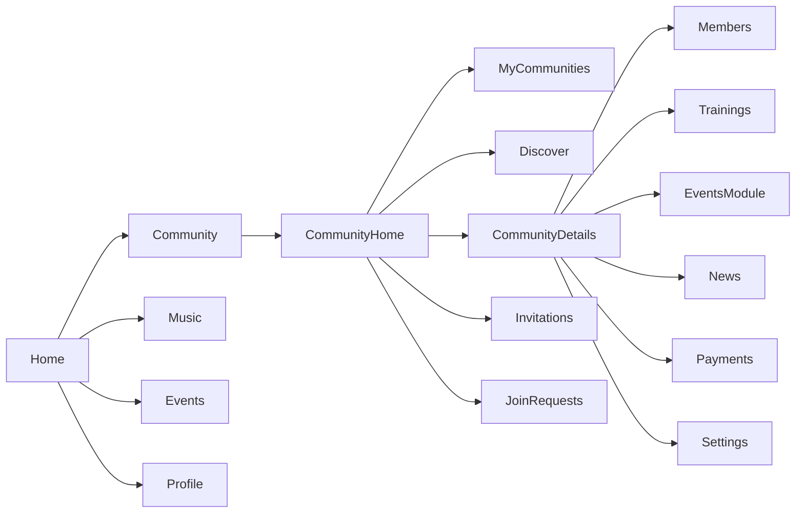
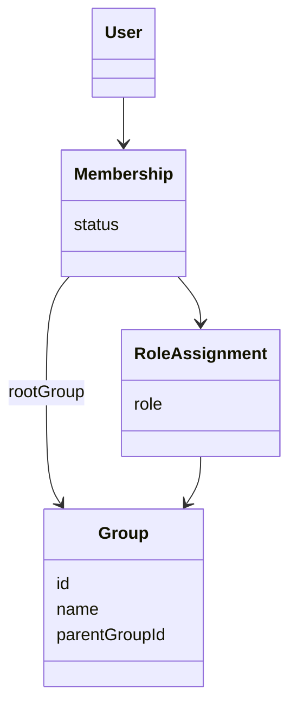
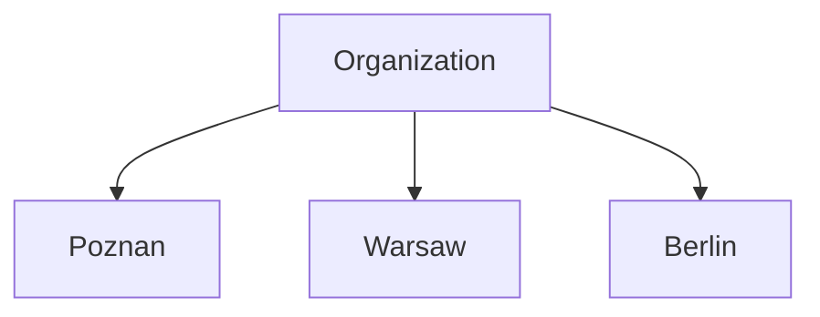

# PAD-001 – Community Module Architecture

**Projekt:** CapoHub

**Moduł:** Community

**Status:** Draft v1.1 (reconciled with Organization Domain documentation)

**Autor:** OpenAI + Project Owner

**Ostatnia aktualizacja:** 2026-07-22

---

## Relationship to Organization Domain Documentation

This document describes the **Community module**: its purpose, UX,
screens, navigation, and the way it exposes other modules — not the
underlying business/domain model.

The business/domain model — Group, Membership, Role, RoleAssignment,
Hierarchy, Ownership, Permissions, Graduation, Academy, Section,
Invitation — is owned exclusively by the **Organization Domain**
documentation set:

- [organization-domain.md](organization-domain.md) — main architecture document
- [organization-entities.md](organization-entities.md) — per-entity reference
- [organization-scenarios.md](organization-scenarios.md) — business scenarios
- [decisions/](../decisions/) — ADR-001 through ADR-028
- [product/glossary.md](../product/glossary.md) — canonical terminology
- [product/vision.md](../product/vision.md) — cross-domain philosophy

Wherever this document previously restated a business rule already defined
there, it now links to it instead. If this document and the Organization
Domain documentation ever appear to disagree, the Organization Domain
documentation is authoritative for the domain model, and this document
should be corrected to match it (see `docs/README.md`'s Provenance Note).

---

# 1. Purpose

## 1.1 Overview

Community is the social core of CapoHub.

Its purpose is to manage organizations, groups and memberships while providing users with a central place to interact with the capoeira community.

Community is **not** responsible for implementing every feature related to organizations.

Instead, it acts as an entry point to specialized modules such as:

- Members
- Trainings
- Events
- News
- Payments
- Settings

Community provides context, navigation and management of social structures.

---

## 1.2 Goals

The module must allow users to:

- discover organizations and groups
- join communities
- create communities
- manage communities
- browse community information
- navigate to community-related features
- receive invitations
- manage memberships

Community should remain lightweight and avoid becoming a "god module".

---

## 1.3 Non-goals

Community is **not** responsible for:

- training management
- event management
- payment processing
- member management logic
- attendance
- examinations

Those features belong to dedicated modules.

Community only exposes entry points and high-level summaries.

---

# 2. Domain Model

Community is a UI concept layered on top of a single backend entity:
`Group`. It does not introduce, redefine, or duplicate any part of the
domain model — see
[organization-domain.md](organization-domain.md#organization-model) and
[organization-entities.md](organization-entities.md#group) for the full
Group/Organization/Hierarchy model, and
[product/glossary.md](../product/glossary.md) for exact terminology
(`Group`, `Root Group`, `Child Group`, `Organization`). In particular, the
"Groups inherit selected information from their parent" mechanism (logo,
cover image, description, history) is the Organization Domain's dynamic
Inheritance mechanism — see
[organization-domain.md#inheritance](organization-domain.md#inheritance)
and [ADR-006](../decisions/ADR-006-dynamic-inheritance.md).

## 2.1 Community

Within the application, the term **Community** refers collectively to:

- organizations (Root Groups)
- groups (Child Groups)

It is a UI concept only. There is no `Community` entity in the backend —
every screen described in this document is backed by the `Group` entity
defined in the Organization Domain documentation.

---

# 3. Design Principles

The following principles should guide all future development of the Community module.

---

## 3.1 Community is a Hub

Community should connect users with other modules.

It should never duplicate functionality.

Bad:

```text
Community

↓

Huge training manager
Huge event manager
Huge payments manager
Huge member manager
```

Good:

```text
Community

↓

Members

↓

Trainings

↓

Events

↓

Payments

↓

Settings
```

---

## 3.2 Single Source of Truth

Every piece of information should have one owner.

Examples:

| Information | Owner            |
| ----------- | ---------------- |
| Graduation  | Organization     |
| Members     | Group            |
| Events      | Events Module    |
| Trainings   | Trainings Module |
| Payments    | Payments Module  |

Community only displays summaries.

---

## 3.3 Shared Screens

Organizations and groups should reuse the same screens whenever possible.

The frontend should determine the displayed type using backend data rather than maintaining separate implementations.

Example:

```ts
if (parentGroup == null) {
  // Organization
} else {
  // Group
}
```

This minimizes duplicated UI and simplifies future maintenance.

---

## 3.4 Composition over Duplication

Whenever a feature can be shared between organizations and groups, it should be implemented once.

Examples:

- Community Details
- Edit Community
- Members List
- News List
- Event List

Different behavior should be achieved through permissions and configuration instead of separate screens.

---

# 4. Community Hierarchy

The backend hierarchy has **no depth limit** — see
[Hierarchy](organization-domain.md#hierarchy) and
[ADR-002](../decisions/ADR-002-unlimited-group-hierarchy.md). An earlier
draft of this document assumed a fixed two-level depth (Organization →
Group); that assumption was incorrect and has been removed here — it
contradicted the already-implemented and tested Organization Domain model,
which explicitly supports arbitrarily deep structures, e.g.:

```
World

└── Continent

    └── Country

        └── Region

            └── City

                └── School
```

Community's navigation nonetheless stays shallow by design (see
[§16 Navigation Philosophy](#16-navigation-philosophy)): every level of the
hierarchy is presented through the same `Community Details` screen (see
[§3.3 Shared Screens](#33-shared-screens)), so the UI never needs
special-case logic for a particular depth. In practice most real
organizations only use two levels — Organization and its Groups — but this
is a fact about how organizations tend to configure themselves, not a
constraint enforced by the backend or required by the frontend.

---

# 5. Membership Model

Membership rules (how many organizations/groups a user may belong to,
lifecycle, multi-organization support) are defined in
[organization-domain.md](organization-domain.md#membership) and
[organization-entities.md](organization-entities.md#membership). Community
only needs the practical consequence for its screens: a user's "My
Communities" list (see [§11 My Communities](#11-my-communities)) can show
any number of organizations, and within each, any number of groups, each
with independent permissions.

---

# 6. Roles

Roles are assigned per membership, per Group — never globally. The full
rules (fixed system Role enum, a membership may hold several Roles for the
same Group at once, no inheritance across the hierarchy) are defined in
[organization-domain.md](organization-domain.md#roles) and
[organization-entities.md](organization-entities.md#roleassignment); the
canonical Role values are listed in
[product/glossary.md](../product/glossary.md).

Example, using the current system roles (`Owner`, `Admin`, `Instructor`,
`Assistant`, `Member`):

| Community      | Role(s)              |
| -------------- | --------------------- |
| Organization A | Member                |
| Group Poznań   | Member + Instructor   |
| Group Warszawa | Member + Admin        |
| Organization B | Member                |

A user's role in a given community is therefore a **list**, not a single
value — see [§19.1 Community DTO](#191-community-dto).

The backend already supports this model.

---

# 7. Community Ownership

Every community (Organization or Group) has exactly one mandatory `Owner`,
plus zero or more `Admin`s. The full ownership rules — why exactly one
Owner is required, how ownership transfer works, and why a membership can
never end while it still owns any Group — are defined in
[organization-domain.md](organization-domain.md#roles) and
[organization-entities.md](organization-entities.md#roleassignment); see
also the **Owner (Role)** entry in
[product/glossary.md](../product/glossary.md).

From the Community module's perspective, Owners and Admins are
responsible for:

- editing community information
- approving members
- publishing news
- managing local settings
- delegating permissions

Ownership is always explicit — there is no concept of an "implicit
owner".

---

# 8. Architectural Decisions

## AD-001

Organization is implemented as a root group.

Status:

**Accepted**

---

## AD-002

Community is a navigation hub rather than a feature implementation module.

Status:

**Accepted**

---

## AD-003

Organizations and groups share the same UI wherever possible.

Status:

**Accepted**

---

## AD-004

~~Community hierarchy is limited to two levels.~~

**Superseded.** This contradicted
[ADR-002](../decisions/ADR-002-unlimited-group-hierarchy.md) (Accepted),
which is already implemented and tested. Hierarchy depth is unlimited —
see [§4 Community Hierarchy](#4-community-hierarchy).

Status:

**Superseded by ADR-002**

# 9. Navigation Architecture

## 9.1 Position in the Application

Community is one of the primary modules of CapoHub and is available directly from the bottom navigation.

```
Home

Community

Music

Events

Profile
```

Community owns its own navigation stack.

It is completely independent from:

- Music
- Events
- Profile

Other modules may open Community screens, but Community does not depend on them.

---

## 9.2 Navigation Stack

```
Community

├── Home
│
├── My Communities
│
├── Discover
│
├── Community Details
│
├── Create Community
│
├── Edit Community
│
├── Invitations
│
└── Join Requests
```

Future screens:

```
Members
Trainings
Events
News
Payments
Settings
```

These screens belong to dedicated modules but may be opened from Community.

---

# 10. Community Home

## Purpose

Community Home is a dashboard.

It is **not** a list of communities.

It is **not** an explorer.

It is a personalized overview showing information requiring the user's attention.

---

## Responsibilities

Community Home should answer:

- What happened?
- What requires my attention?
- Which communities do I belong to?
- What should I do next?

---

## Content

Typical sections:

### News Feed

Latest news from communities the user belongs to.

Mixed chronological feed.

Example:

```
Poznań

Training moved to 18:30

-------------------------

Cordão de Ouro

Batizado registration opened

-------------------------

Berlin

Workshop this Saturday
```

---

### Invitations

Pending invitations to:

- organizations
- groups

Quick actions:

- Accept
- Decline

---

### Pending Join Requests

Visible only to administrators.

Contains requests waiting for approval.

---

### My Communities

Horizontal list.

Shows:

- logo
- name
- user role

Selecting an item opens Community Details.

---

### Quick Actions

Examples:

```
Create Community

Browse Communities

Create Group

Invite Members
```

Available actions depend on permissions.

---

## What should NOT appear here

Community Home should not contain:

- full member lists
- training calendars
- event management
- payment management
- settings

Those belong elsewhere.

---

# 11. My Communities

## Purpose

Displays all communities related to the current user.

Includes:

- organizations
- groups

Grouped by organization.

Example:

```
Cordão de Ouro

    Poznań

    Warszawa

-----------------------

Abadá

    Berlin

-----------------------

Muzenza

    Kraków
```

---

## Features

Supported actions:

- open details
- search
- filter
- sort

Future:

- pin favorites
- recently opened
- archived memberships

---

# 12. Discover

## Purpose

Allows users to discover new communities.

Community discovery should feel similar to discovering servers on Discord or communities on Facebook.

---

## Features

Search by:

- name
- city
- country
- instructor
- organization

Filters:

- public/private
- country
- city
- organization

Sorting:

- newest
- most members
- alphabetical
- nearest

---

## Community Card

Every result should display:

- logo
- name
- organization
- location
- member count
- short description

Actions:

```
Open

Join

Request Access
```

---

# 13. Community Details

Community Details is the central screen of the module.

Organizations and groups share the same implementation.

The frontend determines the displayed type from backend data.

---

## Header

Contains:

- logo
- name
- organization (if group)
- location
- short description

Action buttons:

- Share
- More
- Edit (permission based)

---

## Information Section

General information about the community.

Examples:

- description
- founded
- website
- contact
- location
- training locations

---

## History

History of the organization or group.

Rich text.

Supports images in future versions.

---

## Graduation

Displays the organization's graduation system.

For groups:

Read-only inherited data.

Editing is available only on the organization level.

The Graduation model itself (`GraduationSystem`, `GraduationCategory`,
`GraduationLevel`, `UserGraduationEntry`, `UserCurrentGraduation`) is owned
by the Organization Domain — see
[organization-entities.md](organization-entities.md#graduationsystem) and
[ADR-005](../decisions/ADR-005-root-group-graduation-system.md). As of
this writing the Graduation aggregate has not been implemented yet (see
the Implementation Checklist in
[organization-domain.md](organization-domain.md#implementation-checklist));
this section only describes how Community should present it once it
exists.

---

## Instructors

Displays members holding the `Instructor` Role for this community (see
[Roles](organization-domain.md#roles) for the underlying Role model).
This list should support:

- hierarchy
- profile picture
- biography
- contact links

Profile picture, biography, and contact links are presentation data
attached to a user profile — they are not part of the Organization
Domain's Role/RoleAssignment model itself.

---

## Navigation Cards

Community Details should not contain huge lists.

Instead it provides entry points.

```
Members

>

Trainings

>

Events

>

News

>

Payments

>

Settings

>
```

Each card opens a dedicated module.

---

# 14. Create Community

One screen handles both:

- organizations
- groups

---

## Community Type

Required selection.

```
○ Organization

○ Group
```

---

If Organization is selected:

No parent organization is required.

Backend:

```
parentGroup = null
```

---

If Group is selected:

The user must choose a parent organization.

```
Organization

▼
```

---

## Basic Information

Required:

- name
- description

Optional:

- logo
- cover image
- website
- email
- phone
- location
- social links

---

## Visibility

The backend models discoverability and join access as two independent
toggles on `Group` (see
[organization-entities.md](organization-entities.md#discovery-and-join-settings)
for the authoritative field reference), not a single `Public`/`Private`
choice:

- **Public join (`isPublic`)** — when on, `Join` is immediate; when off,
  joining creates a request that an Admin/Owner must approve ("Request
  Access").
- **Listed in Discover (`isHidden`, shown inverted)** — when the community
  is hidden, it is excluded from [Discover](#12-discover) search results,
  but remains joinable by anyone with its link, public code, or QR code.

The Create/Edit Community screen should present these as two switches,
not a single `Public`/`Private` radio choice, since all four combinations
are valid and already supported by the backend (e.g. "joinable only by
invite, but still searchable" or "open to join, but not listed").

Future:

- Invite Only (would replace or augment `isPublic`; not yet designed)

---

# 15. Edit Community

Uses the same layout as Create Community.

Differences:

- fields prefilled
- permission validation
- delete option

Community type cannot be changed.

Example:

Organization → Group

is not supported.

---

# 16. Navigation Philosophy

Community should never become a deep navigation tree.

Maximum expected depth:

```
Community

↓

Community Details

↓

Members

↓

Member Details
```

Deep structures such as:

```
Community

↓

Members

↓

Member

↓

Trainings

↓

Attendance

↓

History
```

should be avoided.

Whenever navigation becomes too deep, responsibility should move to another module.

# 17. Permission Model

Permissions are never global — they are resolved per membership, per
community, exactly as defined in
[organization-domain.md](organization-domain.md#permissions) and
[organization-entities.md](organization-entities.md#roleassignment) (`User
→ Membership → RoleAssignment(s) for this Group → union of Permissions`).
There is no concept of a global administrator for Community actions. A
user may hold different Roles — and therefore different Permissions — in
every community they belong to, at the same time (e.g. Admin in one,
Instructor in another, plain Member in a third).

Community's job is only to open every screen already scoped to the
correct community, and to rely on the resolution above for whichever
community is currently open. It does not re-implement, cache, or
duplicate permission resolution itself.

## 17.4 Permission Categories

Community itself exposes only the permission categories already backed by
the `Group` entity today:

**Community Management** — Edit community, Archive/Unarchive community,
Set/lift Read-Only, Transfer ownership.

**Members** — Invite members, Add/Remove members, Change roles
(grant/revoke Role Assignments), Assign/unassign Sections.

Categories such as **Content**, **Trainings**, **Events**, **Payments**,
and **Settings** belong to their own future modules, not to Community
(see [§1.3 Non-goals](#13-non-goals) and the Organization Domain's
[Dependency Rules](organization-domain.md#dependency-rules), which keep
the domain model independent of those modules). When those modules are
built, each will define and enforce its own permission set, evaluated
against the same per-membership Role a user holds for the relevant Group —
Community only provides the navigation entry point (see
[§3.1 Community is a Hub](#31-community-is-a-hub)), never the permission
logic for what it links to.

The backend remains the single source of truth. Frontend only adapts UI.

---

# 18. State Management

## 18.1 Principles

Community should follow the same architecture as the rest of CapoHub.

Responsibilities should be clearly separated.

```
Backend

↓

API Client

↓

React Query

↓

View Models

↓

UI
```

---

## 18.2 React Query

Server data should always be cached using React Query.

Typical queries:

```
communities

community

communityMembers

communityNews

communityTrainings

communityEvents

communityInvitations
```

Mutations:

```
createCommunity

updateCommunity

joinCommunity

leaveCommunity

approveRequest

rejectRequest
```

---

## 18.3 Local UI State

Ephemeral UI state should remain local.

Examples:

- opened accordion
- selected tab
- search query
- filters
- modal visibility

Global stores should not contain temporary UI state.

---

## 18.4 Shared Stores

Only cross-screen state belongs in a global store.

Examples:

- selected filters
- recently opened communities
- cached preferences

Everything else should remain inside screen components.

---

# 19. Backend Integration

Community never owns business logic.

The backend is responsible for:

- validation
- authorization
- hierarchy
- permissions
- relationships

The frontend renders data only.

---

## 19.1 Community DTO

The authoritative field list is whatever the backend's `GroupResponseDto`
/ `GroupSummaryResponseDto` actually returns (see
[organization-entities.md](organization-entities.md#group) for the
business fields, and the backend source for the exact response shape) —
this document does not redefine it. A few points are worth calling out
because they differ from earlier drafts of this section:

- Visibility is two independent flags (`isPublic`, `isHidden`), not a
  single `visibility` enum — see [§14 Visibility](#visibility).
- A user's role in a community is a **list**, not a single value — a
  membership may hold several Roles for the same Group at once (see
  [§6 Roles](#6-roles)). Model it as `roles: Role[]`, never `role: Role`.
- `memberCount` and `location` are not yet fields on `Group` — see the
  Organization Domain's Implementation Checklist and Future Extensions for
  their status. Community screens that need them should treat them as
  optional/absent until they exist, rather than assuming presence.

Frontend should avoid assumptions beyond what the backend actually
returns.

---

## 19.2 View Models

Screens should never consume raw DTOs directly.

Instead:

```
DTO

↓

Mapper

↓

View Model

↓

UI
```

Example:

```
CommunityDto

↓

CommunityCardModel

↓

CommunityCard
```

This isolates backend changes.

---

# 20. UI Architecture

Community should be composed from reusable building blocks.

Examples:

```
CommunityCard

CommunityHeader

CommunitySection

CommunityRoleBadge

CommunityAvatar

CommunityStatistic

CommunityActionButton

CommunityNavigationCard
```

Screens should assemble components rather than implement custom layouts repeatedly.

---

# 21. Screen Composition

Recommended structure:

```
CommunityScreen

├── Header

├── Summary

├── Sections

├── Navigation

└── Floating Actions
```

Avoid screens longer than necessary.

Prefer navigation over endless scrolling.

---

# 22. Loading Strategy

Every screen should support:

- loading
- empty
- success
- error

Example:

```
Loading

↓

Skeleton

↓

Success

↓

Refresh
```

Avoid blank screens.

---

# 23. Error Handling

Errors should be categorized.

Recoverable:

- network timeout
- refresh required
- offline

Permission:

- forbidden
- membership removed

Fatal:

- community deleted
- community unavailable

Every error state should provide a meaningful recovery path.

---

# 24. Offline Behaviour

Community should remain partially usable offline.

Available:

- cached community list
- cached details
- cached members
- cached news

Unavailable:

- creating communities
- editing
- joining
- approving requests

Offline indicators should be explicit.

---

# 25. Search

Search should exist only where it makes sense.

Community Home

❌ No search

My Communities

✅ Search

Discover

✅ Search

Members

✅ Search

News

Optional

Trainings

Optional

Search should always be server-driven when datasets become large.

---

# 26. Performance

Community is expected to scale.

Requirements:

- lazy loading
- pagination
- virtualization
- image caching
- optimistic updates where appropriate

Large organizations with thousands of members should remain responsive.

---

# 27. Analytics

Community should expose analytics events.

Examples:

```
community_opened

community_created

community_join_requested

community_joined

community_left

community_shared

community_invitation_accepted

community_invitation_declined
```

Analytics implementation remains outside this module.

---

# 28. Extensibility

Community must remain open for future features.

Examples:

- Following communities
- Community verification
- Official organizations
- Community rankings
- Community achievements
- Marketplace
- Sponsors
- Donations
- Public community pages
- Federation support

The architecture should not require major refactoring to support these additions.

# 29. UX Principles

The Community module should follow a small set of consistent UX principles.

These principles apply to every future screen.

---

## 29.1 Community First

The user should always know which community they are interacting with.

Every screen related to a specific community should clearly display:

- community logo
- community name
- organization (if applicable)

Community context should never be ambiguous.

---

## 29.2 One Responsibility Per Screen

Each screen should have one clear purpose.

Examples:

Good

```
Community Details
```

```
Members
```

```
Events
```

Bad

```
Community Details

↓

Members

↓

Events

↓

Payments

↓

Trainings

↓

News

↓

Settings

(all on one screen)
```

Whenever a screen becomes too large, functionality should move into a dedicated screen.

---

## 29.3 Progressive Disclosure

Do not overwhelm users.

Show only information that is relevant at the current level.

Example:

Community Details

↓

Statistics

↓

Navigation Cards

↓

Open Members

↓

Member Details

instead of displaying every member immediately.

---

## 29.4 Permission Transparency

The interface should clearly communicate what the user can and cannot do.

Examples:

✔ Visible Edit button

✔ Disabled action with explanation

✔ Hidden actions for unavailable features

Avoid confusing situations where an action silently fails.

---

## 29.5 Consistency

Community screens should reuse the same interaction patterns.

Examples:

Cards

Lists

Buttons

Bottom sheets

Dialogs

Forms

Headers

Navigation

Every screen should feel familiar.

---

# 30. Naming Conventions

The following terminology should be used consistently.

## UI

Community

Organization

Group

Members

Trainings

Events

News

Payments

Settings

Invitations

Join Requests

---

## Backend

Group

Membership

Role

Permission

Parent Group

Root Group

---

## Internal

Community =

Organization OR Group

Organization =

Root Group

Group =

Child Group

These terms should never be mixed.

---

# 31. Future Evolution

The following features are expected in future versions.

Community Following

Community Verification

Community Recommendations

Community Rankings

Community Achievements

Public Community Pages

Sponsors

Donations

Marketplace

Federations

Community Statistics

Community Insights

The current architecture should support these additions without major redesign.

---

# 32. Open Questions

The following topics remain intentionally undecided.

## Verification

Should organizations become officially verified?

Status:

Future discussion.

---

## Following

Should users be able to follow organizations without joining them?

Status:

Future discussion.

---

## Public Pages

Should every organization have a public web page?

Status:

Future discussion.

---

## Federation Layer

Should organizations be grouped into federations?

Status:

Future discussion.

---

## Community Discovery Ranking

How should Discover sort organizations?

Possible signals:

- popularity
- activity
- distance
- instructor reputation

Status:

Future discussion.

---

# 33. Architectural Constraints

The following constraints should always remain true for the **Community
module**. Constraints about the underlying domain model itself (hierarchy
depth, ownership, permission resolution) live in
[organization-domain.md's Hierarchy Rules](organization-domain.md#hierarchy-rules)
and are not repeated here.

✓ Organization is a Root Group.

✓ Groups belong to exactly one Organization (their Root Group).

✓ Hierarchy depth is unlimited (owned by Organization Domain — see
[ADR-002](../decisions/ADR-002-unlimited-group-hierarchy.md)); Community
never hardcodes a depth assumption.

✓ Community is a navigation hub.

✓ Business logic belongs to backend.

✓ Specialized modules own their own data.

✓ Community displays summaries.

✓ Permissions are membership-based.

✓ Organization and Group reuse the same UI.

Any future proposal violating these constraints should be considered an architectural change and evaluated carefully.

---

# 34. Related Documents

Architecture

- PAD-001 Community (this document)
- [organization-domain.md](organization-domain.md) — Organization Domain business model (authoritative for Group, Membership, Role, Hierarchy, Permissions, Graduation)
- [organization-entities.md](organization-entities.md) — per-entity reference
- [organization-scenarios.md](organization-scenarios.md) — business scenarios
- PAD-002 Events (future)
- PAD-003 Profile (future)
- PAD-004 Home (future)
- PAD-005 Music (future)

Technical

- API Specification (future)
- Frontend Architecture (future)
- Backend Architecture (future)
- Design System (future)
- Permission Matrix (future)

Decision Records

See [docs/decisions/](../decisions/) for the full list (ADR-001 through
ADR-028). Most relevant to Community: ADR-001 (No Organization Entity),
ADR-002 (Unlimited Group Hierarchy), ADR-004 (No Membership Inheritance),
ADR-013 (No Permission Inheritance), ADR-028 (Role Assignment Model). The
`AD-00X` entries in [§8 Architectural Decisions](#8-architectural-decisions)
above are this document's own, Community-specific decisions — a separate
numbering space from the project-wide ADRs in `docs/decisions/`.

Product

- [product/vision.md](../product/vision.md) — cross-domain philosophy
- [product/glossary.md](../product/glossary.md) — canonical terminology

---

# 35. Changelog

## v1.1

Reconciled with the Organization Domain documentation set
(`organization-domain.md`, `organization-entities.md`,
`organization-scenarios.md`, ADR-001 through ADR-028), following a backend
compliance audit. Key changes:

- Removed the incorrect "maximum hierarchy depth of two" claim (§4, §8
  AD-004, §33) — the backend hierarchy is unlimited (ADR-002), already
  implemented and tested.
- Removed duplicated domain-model content (Organization, Group,
  Membership, Roles, Ownership, Permission resolution) in favor of links
  to the Organization Domain documentation, which now owns that content.
- Corrected the Visibility model (§14, §19.1) from a single `PUBLIC`/
  `PRIVATE` enum to the actual two-flag model (`isPublic`, `isHidden`).
- Corrected the Community DTO sketch (§19.1) and Roles example (§6) to
  reflect that a membership can hold multiple Roles per community
  (`roles: Role[]`), not a single `role`.
- Narrowed Permission Categories (§17.4) to what Community actually owns
  today (Community Management, Members), removing Trainings/Events/
  Payments categories that belong to future, independent modules.
- Fixed §34 Related Documents, which previously listed a fictional set of
  ADR titles inconsistent with the real `docs/decisions/` ADRs.

## v1.0

Initial architecture.

Defines:

- domain model
- hierarchy
- navigation
- community responsibilities
- permission model
- UI principles
- architectural constraints

This version serves as the foundation for all future Community development.

---

# Appendix A — High Level Navigation



---

# Appendix B — Domain Model

This diagram is illustrative only; the authoritative model (including
`RoleAssignment`, why `Membership` never stores a `role`, and why a
`RoleAssignment` may repeat per Group) is defined in
[organization-entities.md](organization-entities.md) — see
[entity-overview.mmd](../diagrams/entity-overview.mmd) for the full
entity-relationship diagram.



---

# Appendix C — Community Hierarchy



---

# Approval

This document defines the architectural foundation of the Community module.

All future implementation work should follow the principles described here.

Any change affecting this document should be introduced through a new version or an Architecture Decision Record (ADR).
