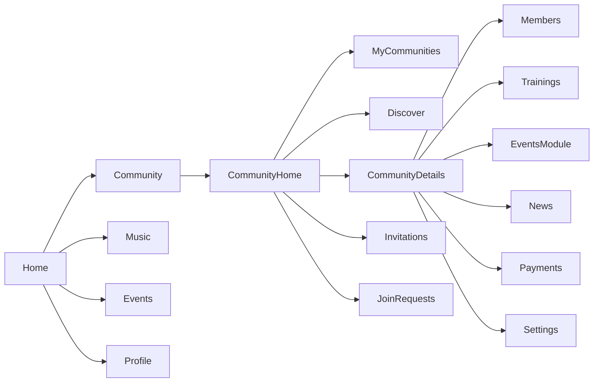
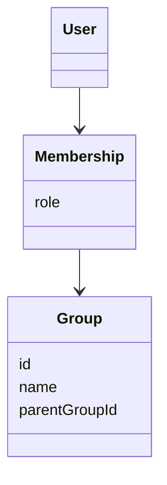
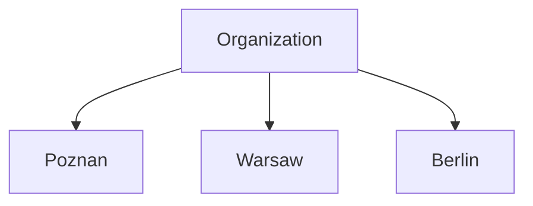

# PAD-001 – Community Module Architecture

**Projekt:** CapoHub

**Moduł:** Community

**Status:** Draft v1.0

**Autor:** OpenAI + Project Owner

**Ostatnia aktualizacja:** 2026-07

---

# 1. Purpose

## 1.1 Overview

Community is the social core of CapoHub.

Its purpose is to manage organizations, groups and memberships while providing users with a central place to interact with the capoeira community.

Community is **not** responsible for implementing every feature related to organizations.

Instead, it acts as an entry point to specialized modules such as:

- Members
- Trainings
- Events
- News
- Payments
- Settings

Community provides context, navigation and management of social structures.

---

## 1.2 Goals

The module must allow users to:

- discover organizations and groups
- join communities
- create communities
- manage communities
- browse community information
- navigate to community-related features
- receive invitations
- manage memberships

Community should remain lightweight and avoid becoming a "god module".

---

## 1.3 Non-goals

Community is **not** responsible for:

- training management
- event management
- payment processing
- member management logic
- attendance
- examinations

Those features belong to dedicated modules.

Community only exposes entry points and high-level summaries.

---

# 2. Domain Model

Community is built around one core entity:

```
Group
```

There is no separate Organization entity.

Organizations are represented by root groups.

---

## 2.1 Organization

An organization is defined by:

```ts
parentGroup == null;
```

Every root group is an organization.

Every organization is a root group.

These two concepts are equivalent throughout the system.

There is no scenario where:

- a root group is not an organization
- an organization is not a root group

This is one of the fundamental architectural decisions of the project.

---

## 2.2 Group

A group always belongs to exactly one organization.

```text
Organization

└── Group
```

Groups inherit selected information from their parent organization.

Examples:

- graduation system
- organization identity
- instructors hierarchy
- branding

Groups maintain their own local data such as:

- members
- trainings
- local news
- local events

---

## 2.3 Community

Within the application, the term **Community** refers collectively to:

- organizations
- groups

It is a UI concept.

There is no Community entity in the backend.

---

# 3. Design Principles

The following principles should guide all future development of the Community module.

---

## 3.1 Community is a Hub

Community should connect users with other modules.

It should never duplicate functionality.

Bad:

```text
Community

↓

Huge training manager
Huge event manager
Huge payments manager
Huge member manager
```

Good:

```text
Community

↓

Members

↓

Trainings

↓

Events

↓

Payments

↓

Settings
```

---

## 3.2 Single Source of Truth

Every piece of information should have one owner.

Examples:

| Information | Owner            |
| ----------- | ---------------- |
| Graduation  | Organization     |
| Members     | Group            |
| Events      | Events Module    |
| Trainings   | Trainings Module |
| Payments    | Payments Module  |

Community only displays summaries.

---

## 3.3 Shared Screens

Organizations and groups should reuse the same screens whenever possible.

The frontend should determine the displayed type using backend data rather than maintaining separate implementations.

Example:

```ts
if (parentGroup == null) {
  // Organization
} else {
  // Group
}
```

This minimizes duplicated UI and simplifies future maintenance.

---

## 3.4 Composition over Duplication

Whenever a feature can be shared between organizations and groups, it should be implemented once.

Examples:

- Community Details
- Edit Community
- Members List
- News List
- Event List

Different behavior should be achieved through permissions and configuration instead of separate screens.

---

# 4. Community Hierarchy

The hierarchy of communities is intentionally simple.

```
Organization

├── Group
├── Group
├── Group
└── Group
```

Nested groups are not supported.

Maximum depth:

```
2
```

There is no hierarchy like:

```
Organization

└── Group

    └── Subgroup

        └── Subgroup
```

Supporting deeper structures would unnecessarily complicate:

- permissions
- navigation
- memberships
- inheritance

and does not reflect the real structure of most capoeira organizations.

---

# 5. Membership Model

A user may belong to:

- zero organizations
- one organization
- multiple organizations

Within every organization the user may belong to:

- zero groups
- one group
- multiple groups

There are no global membership restrictions.

Example:

```
User

├── Cordão de Ouro
│
│   ├── Poznań
│   └── Warszawa
│
└── Abadá

    └── Berlin
```

The same user may have different permissions in every membership.

---

# 6. Roles

Roles are assigned per membership.

They are **not global**.

Example:

| Community      | Role       |
| -------------- | ---------- |
| Organization A | Member     |
| Group Poznań   | Instructor |
| Group Warszawa | Admin      |
| Organization B | Viewer     |

The backend already supports this model.

---

# 7. Community Ownership

Every community has one or more administrators.

Administrators are responsible for:

- editing community information
- approving members
- publishing news
- managing local settings
- delegating permissions

Ownership is always explicit.

There is no concept of an "implicit owner".

---

# 8. Architectural Decisions

## AD-001

Organization is implemented as a root group.

Status:

**Accepted**

---

## AD-002

Community is a navigation hub rather than a feature implementation module.

Status:

**Accepted**

---

## AD-003

Organizations and groups share the same UI wherever possible.

Status:

**Accepted**

---

## AD-004

Community hierarchy is limited to two levels.

Status:

**Accepted**

# 9. Navigation Architecture

## 9.1 Position in the Application

Community is one of the primary modules of CapoHub and is available directly from the bottom navigation.

```
Home

Community

Music

Events

Profile
```

Community owns its own navigation stack.

It is completely independent from:

- Music
- Events
- Profile

Other modules may open Community screens, but Community does not depend on them.

---

## 9.2 Navigation Stack

```
Community

├── Home
│
├── My Communities
│
├── Discover
│
├── Community Details
│
├── Create Community
│
├── Edit Community
│
├── Invitations
│
└── Join Requests
```

Future screens:

```
Members
Trainings
Events
News
Payments
Settings
```

These screens belong to dedicated modules but may be opened from Community.

---

# 10. Community Home

## Purpose

Community Home is a dashboard.

It is **not** a list of communities.

It is **not** an explorer.

It is a personalized overview showing information requiring the user's attention.

---

## Responsibilities

Community Home should answer:

- What happened?
- What requires my attention?
- Which communities do I belong to?
- What should I do next?

---

## Content

Typical sections:

### News Feed

Latest news from communities the user belongs to.

Mixed chronological feed.

Example:

```
Poznań

Training moved to 18:30

-------------------------

Cordão de Ouro

Batizado registration opened

-------------------------

Berlin

Workshop this Saturday
```

---

### Invitations

Pending invitations to:

- organizations
- groups

Quick actions:

- Accept
- Decline

---

### Pending Join Requests

Visible only to administrators.

Contains requests waiting for approval.

---

### My Communities

Horizontal list.

Shows:

- logo
- name
- user role

Selecting an item opens Community Details.

---

### Quick Actions

Examples:

```
Create Community

Browse Communities

Create Group

Invite Members
```

Available actions depend on permissions.

---

## What should NOT appear here

Community Home should not contain:

- full member lists
- training calendars
- event management
- payment management
- settings

Those belong elsewhere.

---

# 11. My Communities

## Purpose

Displays all communities related to the current user.

Includes:

- organizations
- groups

Grouped by organization.

Example:

```
Cordão de Ouro

    Poznań

    Warszawa

-----------------------

Abadá

    Berlin

-----------------------

Muzenza

    Kraków
```

---

## Features

Supported actions:

- open details
- search
- filter
- sort

Future:

- pin favorites
- recently opened
- archived memberships

---

# 12. Discover

## Purpose

Allows users to discover new communities.

Community discovery should feel similar to discovering servers on Discord or communities on Facebook.

---

## Features

Search by:

- name
- city
- country
- instructor
- organization

Filters:

- public/private
- country
- city
- organization

Sorting:

- newest
- most members
- alphabetical
- nearest

---

## Community Card

Every result should display:

- logo
- name
- organization
- location
- member count
- short description

Actions:

```
Open

Join

Request Access
```

---

# 13. Community Details

Community Details is the central screen of the module.

Organizations and groups share the same implementation.

The frontend determines the displayed type from backend data.

---

## Header

Contains:

- logo
- name
- organization (if group)
- location
- short description

Action buttons:

- Share
- More
- Edit (permission based)

---

## Information Section

General information about the community.

Examples:

- description
- founded
- website
- contact
- location
- training locations

---

## History

History of the organization or group.

Rich text.

Supports images in future versions.

---

## Graduation

Displays the organization's graduation system.

For groups:

Read-only inherited data.

Editing is available only on the organization level.

---

## Instructors

Displays instructors belonging to the community.

Should support:

- hierarchy
- profile picture
- biography
- contact links

The hierarchy belongs to the organization.

---

## Navigation Cards

Community Details should not contain huge lists.

Instead it provides entry points.

```
Members

>

Trainings

>

Events

>

News

>

Payments

>

Settings

>
```

Each card opens a dedicated module.

---

# 14. Create Community

One screen handles both:

- organizations
- groups

---

## Community Type

Required selection.

```
○ Organization

○ Group
```

---

If Organization is selected:

No parent organization is required.

Backend:

```
parentGroup = null
```

---

If Group is selected:

The user must choose a parent organization.

```
Organization

▼
```

---

## Basic Information

Required:

- name
- description

Optional:

- logo
- cover image
- website
- email
- phone
- location
- social links

---

## Visibility

Possible values:

- Public
- Private

Future:

- Invite Only

---

# 15. Edit Community

Uses the same layout as Create Community.

Differences:

- fields prefilled
- permission validation
- delete option

Community type cannot be changed.

Example:

Organization → Group

is not supported.

---

# 16. Navigation Philosophy

Community should never become a deep navigation tree.

Maximum expected depth:

```
Community

↓

Community Details

↓

Members

↓

Member Details
```

Deep structures such as:

```
Community

↓

Members

↓

Member

↓

Trainings

↓

Attendance

↓

History
```

should be avoided.

Whenever navigation becomes too deep, responsibility should move to another module.

# 17. Permission Model

## 17.1 Overview

Permissions are not determined by the user's global role.

Permissions are evaluated **per membership**.

Every action within Community must validate the user's permissions against the currently opened community.

There is no concept of a global administrator.

---

## 17.2 Permission Resolution

Permissions should always be resolved using:

```
User

↓

Membership

↓

Role

↓

Permissions
```

Never:

```
User

↓

Global Role

↓

Permissions
```

---

## 17.3 Community Context

Every permission evaluation is executed in the context of exactly one community.

Example:

```
Community #12

↓

Current Membership

↓

Current Role

↓

Allowed Actions
```

A user may therefore be:

- Administrator in one community
- Instructor in another
- Regular member in another

at exactly the same time.

---

## 17.4 Permission Categories

Community should not expose hundreds of individual permissions.

Instead permissions should be grouped.

Example:

Community Management

- Edit community
- Delete community
- Archive community

Members

- Invite members
- Remove members
- Change roles

Content

- Publish news
- Edit news
- Delete news

Trainings

- Create training
- Edit training

Events

- Create event
- Manage registrations

Payments

- View payments
- Manage payments

Settings

- Update settings
- Manage invitations

The backend remains the single source of truth.

Frontend only adapts UI.

---

# 18. State Management

## 18.1 Principles

Community should follow the same architecture as the rest of CapoHub.

Responsibilities should be clearly separated.

```
Backend

↓

API Client

↓

React Query

↓

View Models

↓

UI
```

---

## 18.2 React Query

Server data should always be cached using React Query.

Typical queries:

```
communities

community

communityMembers

communityNews

communityTrainings

communityEvents

communityInvitations
```

Mutations:

```
createCommunity

updateCommunity

joinCommunity

leaveCommunity

approveRequest

rejectRequest
```

---

## 18.3 Local UI State

Ephemeral UI state should remain local.

Examples:

- opened accordion
- selected tab
- search query
- filters
- modal visibility

Global stores should not contain temporary UI state.

---

## 18.4 Shared Stores

Only cross-screen state belongs in a global store.

Examples:

- selected filters
- recently opened communities
- cached preferences

Everything else should remain inside screen components.

---

# 19. Backend Integration

Community never owns business logic.

The backend is responsible for:

- validation
- authorization
- hierarchy
- permissions
- relationships

The frontend renders data only.

---

## 19.1 Community DTO

Example:

```ts
interface CommunityDto {
  id: string;

  name: string;

  description: string;

  logoUrl?: string;

  coverUrl?: string;

  parentGroupId?: string;

  location?: CommunityLocationDto;

  visibility: 'PUBLIC' | 'PRIVATE';

  memberCount: number;

  role: MembershipRole;
}
```

The exact DTO depends on backend evolution.

Frontend should avoid assumptions.

---

## 19.2 View Models

Screens should never consume raw DTOs directly.

Instead:

```
DTO

↓

Mapper

↓

View Model

↓

UI
```

Example:

```
CommunityDto

↓

CommunityCardModel

↓

CommunityCard
```

This isolates backend changes.

---

# 20. UI Architecture

Community should be composed from reusable building blocks.

Examples:

```
CommunityCard

CommunityHeader

CommunitySection

CommunityRoleBadge

CommunityAvatar

CommunityStatistic

CommunityActionButton

CommunityNavigationCard
```

Screens should assemble components rather than implement custom layouts repeatedly.

---

# 21. Screen Composition

Recommended structure:

```
CommunityScreen

├── Header

├── Summary

├── Sections

├── Navigation

└── Floating Actions
```

Avoid screens longer than necessary.

Prefer navigation over endless scrolling.

---

# 22. Loading Strategy

Every screen should support:

- loading
- empty
- success
- error

Example:

```
Loading

↓

Skeleton

↓

Success

↓

Refresh
```

Avoid blank screens.

---

# 23. Error Handling

Errors should be categorized.

Recoverable:

- network timeout
- refresh required
- offline

Permission:

- forbidden
- membership removed

Fatal:

- community deleted
- community unavailable

Every error state should provide a meaningful recovery path.

---

# 24. Offline Behaviour

Community should remain partially usable offline.

Available:

- cached community list
- cached details
- cached members
- cached news

Unavailable:

- creating communities
- editing
- joining
- approving requests

Offline indicators should be explicit.

---

# 25. Search

Search should exist only where it makes sense.

Community Home

❌ No search

My Communities

✅ Search

Discover

✅ Search

Members

✅ Search

News

Optional

Trainings

Optional

Search should always be server-driven when datasets become large.

---

# 26. Performance

Community is expected to scale.

Requirements:

- lazy loading
- pagination
- virtualization
- image caching
- optimistic updates where appropriate

Large organizations with thousands of members should remain responsive.

---

# 27. Analytics

Community should expose analytics events.

Examples:

```
community_opened

community_created

community_join_requested

community_joined

community_left

community_shared

community_invitation_accepted

community_invitation_declined
```

Analytics implementation remains outside this module.

---

# 28. Extensibility

Community must remain open for future features.

Examples:

- Following communities
- Community verification
- Official organizations
- Community rankings
- Community achievements
- Marketplace
- Sponsors
- Donations
- Public community pages
- Federation support

The architecture should not require major refactoring to support these additions.

# 29. UX Principles

The Community module should follow a small set of consistent UX principles.

These principles apply to every future screen.

---

## 29.1 Community First

The user should always know which community they are interacting with.

Every screen related to a specific community should clearly display:

- community logo
- community name
- organization (if applicable)

Community context should never be ambiguous.

---

## 29.2 One Responsibility Per Screen

Each screen should have one clear purpose.

Examples:

Good

```
Community Details
```

```
Members
```

```
Events
```

Bad

```
Community Details

↓

Members

↓

Events

↓

Payments

↓

Trainings

↓

News

↓

Settings

(all on one screen)
```

Whenever a screen becomes too large, functionality should move into a dedicated screen.

---

## 29.3 Progressive Disclosure

Do not overwhelm users.

Show only information that is relevant at the current level.

Example:

Community Details

↓

Statistics

↓

Navigation Cards

↓

Open Members

↓

Member Details

instead of displaying every member immediately.

---

## 29.4 Permission Transparency

The interface should clearly communicate what the user can and cannot do.

Examples:

✔ Visible Edit button

✔ Disabled action with explanation

✔ Hidden actions for unavailable features

Avoid confusing situations where an action silently fails.

---

## 29.5 Consistency

Community screens should reuse the same interaction patterns.

Examples:

Cards

Lists

Buttons

Bottom sheets

Dialogs

Forms

Headers

Navigation

Every screen should feel familiar.

---

# 30. Naming Conventions

The following terminology should be used consistently.

## UI

Community

Organization

Group

Members

Trainings

Events

News

Payments

Settings

Invitations

Join Requests

---

## Backend

Group

Membership

Role

Permission

Parent Group

Root Group

---

## Internal

Community =

Organization OR Group

Organization =

Root Group

Group =

Child Group

These terms should never be mixed.

---

# 31. Future Evolution

The following features are expected in future versions.

Community Following

Community Verification

Community Recommendations

Community Rankings

Community Achievements

Public Community Pages

Sponsors

Donations

Marketplace

Federations

Community Statistics

Community Insights

The current architecture should support these additions without major redesign.

---

# 32. Open Questions

The following topics remain intentionally undecided.

## Verification

Should organizations become officially verified?

Status:

Future discussion.

---

## Following

Should users be able to follow organizations without joining them?

Status:

Future discussion.

---

## Public Pages

Should every organization have a public web page?

Status:

Future discussion.

---

## Federation Layer

Should organizations be grouped into federations?

Status:

Future discussion.

---

## Community Discovery Ranking

How should Discover sort organizations?

Possible signals:

- popularity
- activity
- distance
- instructor reputation

Status:

Future discussion.

---

# 33. Architectural Constraints

The following constraints should always remain true.

✓ Organization is a Root Group.

✓ Groups belong to exactly one Organization.

✓ Maximum hierarchy depth is two.

✓ Community is a navigation hub.

✓ Business logic belongs to backend.

✓ Specialized modules own their own data.

✓ Community displays summaries.

✓ Permissions are membership-based.

✓ Organization and Group reuse the same UI.

Any future proposal violating these constraints should be considered an architectural change and evaluated carefully.

---

# 34. Related Documents

Future documentation planned for CapoHub.

Architecture

- PAD-001 Community
- PAD-002 Events
- PAD-003 Profile
- PAD-004 Home
- PAD-005 Music

Technical

- API Specification
- Frontend Architecture
- Backend Architecture
- Design System
- Permission Matrix

Decision Records

- ADR-001 Organization = Root Group
- ADR-002 Community is a Hub
- ADR-003 Graduation belongs to Organization
- ADR-004 Membership-based Permissions
- ADR-005 Shared Community Details

---

# 35. Changelog

## v1.0

Initial architecture.

Defines:

- domain model
- hierarchy
- navigation
- community responsibilities
- permission model
- UI principles
- architectural constraints

This version serves as the foundation for all future Community development.

---

# Appendix A — High Level Navigation



---

# Appendix B — Domain Model



---

# Appendix C — Community Hierarchy



---

# Approval

This document defines the architectural foundation of the Community module.

All future implementation work should follow the principles described here.

Any change affecting this document should be introduced through a new version or an Architecture Decision Record (ADR).
